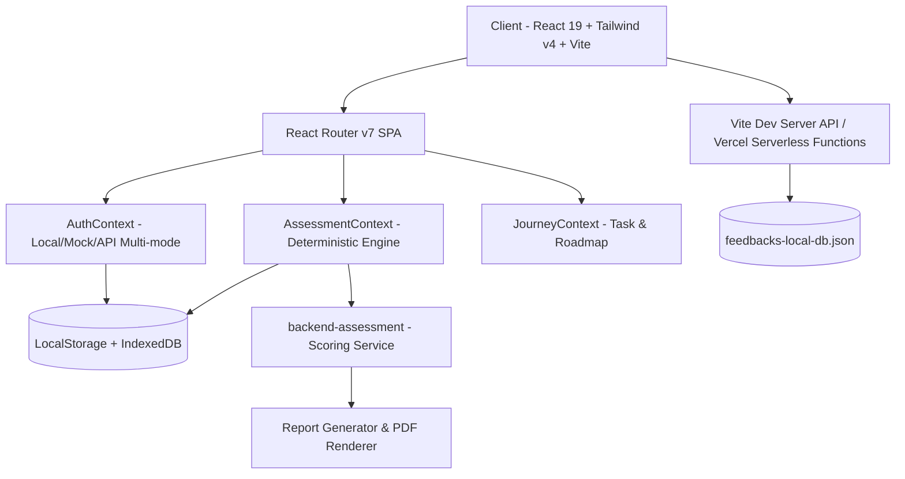

# 🎓 UniView — Nền Tảng Hướng Nghiệp & Tuyển Sinh Đại Học Cá Nhân Hóa

[](https://react.dev/)
[](https://vitejs.dev/)
[](https://tailwindcss.com/)
[](https://nodejs.org/)
[](https://jestjs.io/)
[](https://github.com)

> *"Hiểu mình hơn. Khám phá nhiều hơn. Chọn có cơ sở hơn."*  
> **UniView Vietnam** là nền tảng số hỗ trợ học sinh THPT và phụ huynh định hướng ngành nghề, đánh giá mức độ phù hợp năng lực và đối chiếu dữ liệu tuyển sinh đại học một cách minh bạch, khách quan.

---

## 📌 Mục Lục

- [Giới Thiệu Dự Án](#-giới-thiệu-dự-án)
- [Tính Năng Cốt Lõi](#-tính-năng-cốt-lõi)
- [Kiến Trúc Công Nghệ](#-kiến-trúc-công-nghệ)
- [Cấu Trúc Thư Mục](#-cấu-trúc-thư-mục)
- [Hướng Dẫn Cài Đặt & Khởi Chạy](#-hướng-dẫn-cài-đặt--khởi-chạy)
- [Tài Khoản & Phân Quyền](#-tài-khoản--phân-quyền)
- [Kiểm Thử & Đảm Bảo Chất Lượng](#-kiểm-thử--đảm-bảo-chất-lượng)
- [Biến Môi Trường (.env)](#-biến-môi-trường-env)
- [Đội Ngũ Thực Hiện](#-đội-ngũ-thực-hiện)

---

## 🌟 Giới Thiệu Dự Án

Việc chọn ngành, chọn trường đại học là một trong những quyết định quan trọng nhất của đời học sinh. Tuy nhiên, phần lớn học sinh và phụ huynh hiện nay đối mặt với nhiều khó khăn:
- **Thiếu cơ sở định hướng cá nhân:** Làm các bài trắc nghiệm tính cách rời rạc, không gắn liền với năng lực học tập thực tế và bằng chứng cọ xát.
- **Rối loạn thông tin tuyển sinh:** Điểm chuẩn, học phí, các phương thức xét tuyển (THPT, ĐGNL, chứng chỉ quốc tế) phân mảnh trên hàng chục website trường.
- **Quyết định theo cảm tính:** Chưa từng được trải nghiệm thực tế công việc của ngành học trước khi đăng ký nguyện vọng.

**UniView** ra đời để giải quyết bài toán trên bằng cách kết hợp **mô hình đánh giá 3 chiều (Sở thích RIASEC + Trải nghiệm thực tế + Hồ sơ học tập)** với kho dữ liệu tuyển sinh minh bạch, cung cấp lộ trình hướng nghiệp và đối chiếu điểm chuẩn thực tế.

---

## 🚀 Tính Năng Cốt Lõi

### 1. Khảo Sát Định Hướng 3 Chiều (Personal Assessment)
- **Bước 1 — Sở thích nghề nghiệp (RIASEC):** 30 câu hỏi tình huống chuẩn hóa đo lường 6 nhóm thiên hướng (Realistic, Investigative, Artistic, Social, Enterprising, Conventional).
- **Bước 2 — Hoạt động & Trải nghiệm thực tế:** 8 domain trải nghiệm với ngân hàng câu hỏi thích ứng (Adaptive Bank 1 + 3 + 1) để xác minh độ cọ xát thực tế, tránh ngộ nhận đam mê.
- **Bước 3 — Hồ sơ & Điều kiện cá nhân:** 
  - Chọn năm tuyển sinh, ngân sách học phí, khu vực học tập (TP.HCM & miền Nam, Hà Nội & miền Bắc, Đà Nẵng, Cần Thơ...).
  - Đầy đủ 11 môn thế mạnh THPT chuẩn chương trình GDPT mới.
  - Nhập điểm học bạ (GPA), Điểm thi THPT (thang 30), Điểm thi ĐGNL ĐHQG TP.HCM (thang 1200) kèm phân loại *Chính thức* hoặc *Dự kiến*.
  - **Quản lý đa chứng chỉ quốc tế:** Hỗ trợ IELTS Academic, TOEFL iBT, TOEIC, SAT, ACT, Cambridge, JLPT, HSK, TOPIK...

### 2. Báo Cáo Định Hướng Chuyên Sâu & Xuất Bản PDF
- Thuật toán chấm điểm chuẩn hóa kết hợp RIASEC (40%), Bằng chứng trải nghiệm (35%) và Điều kiện học tập thực tế (25%).
- Hiển thị Radar Chart đa chiều, ma trận so khớp năng lực và danh sách Top ngành phù hợp nhất.
- Tính năng **Xuất báo cáo PDF chất lượng cao** chuẩn in ấn, đầy đủ trang bìa, bảng điểm, chữ ký xác thực.

### 3. Công Cụ Tuyển Sinh (Admission Tools)
- **Admission Checker (Kiểm tra cơ hội trúng tuyển):**
  - So sánh điểm học sinh với điểm chuẩn mùa tuyển sinh gần nhất (2025 - 2026).
  - Hỗ trợ cả 2 phương thức thi: **Điểm thi THPT** và **Điểm ĐGNL ĐHQG-HCM**.
  - Trục số tỷ lệ trực quan, tính toán chênh lệch số học và hiển thị nguồn trích dẫn dữ liệu minh bạch.
- **Personalized University Comparison:** So sánh trường đại học đa tiêu chí (học phí, cơ sở vật chất, việc làm, chuẩn đầu ra).
- **Scenario Comparison:** Thử nghiệm các kịch bản điểm số và ngân sách tài chính.
- **Decision Board & Wishlist:** Lưu trữ, xếp hạng và theo dõi các trường, ngành mục tiêu.

### 4. Roadmap Trải Nghiệm & Task Workspaces
- Học sinh được "thử việc" qua các task thực tế (Kỹ thuật phần mềm, Marketing, Tài chính...) để cảm nhận môi trường thực tế trước khi đặt bút chọn ngành.

### 5. Linh Vật Tương Tác & Hệ Thống Thu Thập Góp Ý
- Linh vật mèo UniView đồng hành cùng người dùng trên toàn bộ các trang với chuyển động nhún mềm mại.
- Hộp thoại đóng góp ý kiến (đánh giá sao, phân loại, nội dung) lưu trữ tự động vào cơ sở dữ liệu trên máy chủ và thiết bị.
- Cơ chế chống spam: tự động tắt lời nhắc phiền toái sau khi người dùng đã gửi phản hồi.

---

## 🛠 Kiến Trúc Công Nghệ



### Công Nghệ Chi Tiết:
| Thành Phần | Công Nghệ Sử Dụng |
|---|---|
| **Core UI Framework** | React 19.2 (Hooks, Suspense, Lazy Loading) |
| **Bundler & Build Tool** | Vite 8.3 |
| **Styling & Design System** | Tailwind CSS v4, DaisyUI v5, CSS Variables, Typography Plugin |
| **Routing** | React Router DOM v7 (Route guards, Search params preservation) |
| **Testing Framework** | Node.js Native Test Runner (`node --test`), Jest, Chrome DevTools Protocol (CDP) |
| **State Management** | React Context API (`AuthContext`, `AssessmentContext`, `JourneyContext`) |
| **Storage & Persistence** | LocalStorage, IndexedDB, Serverless API Endpoints |

---

## 📁 Cấu Trúc Thư Mục

```text
uniview/
├── api/                             # Serverless API endpoints (Vercel Functions)
│   ├── feedback.js                  # API tiếp nhận và lưu trữ feedback góp ý
│   └── feedback.test.js             # Unit test cho API feedback
├── backend-assessment/              # Dịch vụ tính toán điểm và thuật toán đánh giá
│   ├── src/assessment/              # Module chấm điểm RIASEC và Experience
│   └── test/                        # Bộ kiểm thử Jest độc lập cho thuật toán
├── docs/                            # Tài liệu kỹ thuật, schema SQL & ảnh minh chứng test
├── scripts/                         # Kịch bản tự động hóa & kiểm thử hệ thống
│   ├── smokeBrowserTest.js          # Smoke test luồng đăng ký trên Chrome thật (CDP)
│   ├── smokeLoginTest.js            # Smoke test luồng đăng nhập trên Chrome thật
│   └── verifyMascotAndTools.test.js # Kiểm thử tích hợp công cụ tuyển sinh & hồ sơ
├── src/
│   ├── api/                         # Client API calls (authApi, feedbackApi)
│   ├── assets/                      # Hình ảnh linh vật, logo, icon SVG
│   ├── components/                  # UI Components dùng chung
│   │   ├── header/                  # Navbar điều hướng & menu người dùng
│   │   ├── FloatingMascot.jsx       # Linh vật mèo tương tác & popup góp ý
│   │   ├── PageRenderer.jsx         # Trình render trang động & kiểm soát phân quyền
│   │   └── RadarChart.jsx           # Biểu đồ năng lực Radar
│   ├── context/                     # Quản lý trạng thái toàn cục (Auth, Assessment, Journey)
│   ├── data/                        # Dữ liệu tĩnh (universities, majors, careerReport, plans)
│   │   └── profileOptions.js        # Danh mục chuẩn 11 môn THPT, khu vực, học phí
│   ├── pages/                       # Toàn bộ màn hình giao diện người dùng
│   │   ├── LoginPage.jsx            # Đăng nhập (tối ưu khung hình, không demo thừa)
│   │   ├── RegisterPage.jsx         # Đăng ký tài khoản trải nghiệm mới
│   │   ├── ProfilePage.jsx          # Quản lý hồ sơ học sinh & bộ chứng chỉ đa dạng
│   │   ├── QuickProfilePage.jsx     # Bước 3 Assessment (rà soát thực tế)
│   │   ├── AdmissionCheckerPage.jsx # Công cụ kiểm tra điểm THPT & ĐGNL
│   │   └── ReportPdfPage.jsx        # Bản xuất PDF báo cáo định hướng
│   └── utils/                       # Hàm tiện ích (tính điểm, xử lý chứng chỉ, điều hướng)
├── package.json                     # Cấu hình dự án & kịch bản lệnh
├── vite.config.js                   # Cấu hình Vite & mock API middleware
└── README.md                        # Tài liệu hướng dẫn dự án
```

---

## 💻 Hướng Dẫn Cài Đặt & Khởi Chạy

### 1. Yêu Cầu Môi Trường
- **Node.js**: Phiên bản 18.x trở lên (khuyên dùng Node.js 20+ hoặc 24 LTS).
- **Trình duyệt**: Google Chrome hoặc Microsoft Edge mới nhất.

### 2. Cài Đặt Thư Viện

```bash
# Clone repository về máy
git clone <repository-url>
cd uniview

# Cài đặt dependencies cho frontend
npm install

# Cài đặt dependencies cho backend assessment
npm --prefix backend-assessment install
```

### 3. Chạy Môi Trường Phát Triển (Development)

```bash
npm run dev
```
Ứng dụng sẽ khởi chạy tại: `http://localhost:5173/`

### 4. Build Bản Production

```bash
npm run build
```
Kết quả build được xuất ra thư mục `/dist`. Bạn có thể chạy thử bản build bằng lệnh:
```bash
npm run preview
```

---

## 🔑 Tài Khoản & Phân Quyền

UniView hỗ trợ cả trải nghiệm đăng ký tài khoản thật và tài khoản mẫu:

| Loại Tài Khoản | Thông Tin Đăng Nhập | Vai Trò & Gói Dịch Vụ | Mục Đích Sử Dụng |
|---|---|---|---|
| **Tài Khoản Đăng Ký Mới** | Đăng ký trực tiếp tại `/register` | Học sinh (`isDemo: false`) | Trải nghiệm luồng thật: tự điền điểm, làm assessment cá nhân hóa, xuất PDF dữ liệu thật. |
| **Tài Khoản Demo (Minh Anh)** | `minhanh` / `MinhAnh@2026` | Học sinh mẫu (`Gói Năm`) | Xem trước toàn bộ dữ liệu mẫu định hướng ngành Kỹ thuật Phần mềm & Roadmap. |
| **Tài Khoản Quản Trị / Chủ Web** | `lamhuynhhueman.ptht@gmail.com` | Quản trị (`Huỳnh Huệ Mẫn`) | Tự động đồng bộ quyền truy cập Gói Năm cao cấp nhất. |

---

## 🧪 Kiểm Thử & Đảm Bảo Chất Lượng

Dự án duy trì bộ kiểm thử tự động toàn diện, bao phủ từ thuật toán chấm điểm backend đến luồng người dùng trên trình duyệt:

```bash
# 1. Chạy toàn bộ 84 Unit & Integration Tests
npm test
```
*Bao gồm 45 unit tests phía client (`node --test`) và 39 unit tests thuật toán (`backend-assessment`).*

```bash
# 2. Chạy Real-Browser Smoke Test (Chrome CDP)
node scripts/smokeBrowserTest.js
```
*Tự động khởi chạy Chrome headless, mở `/register`, tạo tài khoản mới, xác nhận chuyển hướng `/assessment`, kiểm tra cách ly dữ liệu local session và chụp ảnh màn hình lưu vào `docs/`.*

```bash
# 3. Chạy Smoke Test Luồng Đăng Nhập
node scripts/smokeLoginTest.js
```

---

## ⚙️ Biến Môi Trường (.env)

| Biến Môi Trường | Giá Trị Mặc Định | Ý Nghĩa |
|---|---|---|
| `VITE_API_URL` | `http://localhost:8080/api/v1` | URL endpoint backend production |
| `VITE_AUTH_MODE` | `mock` | Chế độ xác thực: `mock` (local storage) hoặc `api` |
| `VITE_DEMO_SCENARIO` | `ANNUAL_DEMO` | Kịch bản demo mặc định |
| `VITE_MONTHLY_PLAN_PRICE` | `129000` | Giá niêm yết Gói Tháng (VND) |
| `VITE_ANNUAL_PLAN_PRICE` | `1299000` | Giá niêm yết Gói Năm (VND) |
| `VITE_ADMISSION_PASS_PRICE` | `779000` | Giá niêm yết Vé Mùa Tuyển Sinh (VND) |

---

## 👥 Đội Ngũ Thực Hiện

Dự án Capstone Project (EXE) — **Đại học FPT**:
- **Trưởng nhóm & Định hướng sản phẩm**: Huỳnh Huệ Mẫn ([lamhuynhhueman.ptht@gmail.com](mailto:lamhuynhhueman.ptht@gmail.com))
- **Thiết kế UI/UX & Nhân vật linh vật**: Nguyễn Tiến Duy
- **Phát triển Frontend & Thuật toán**: UniView Development Team

---

© 2026 **UniView Vietnam**. Tất cả các quyền được bảo lưu.
